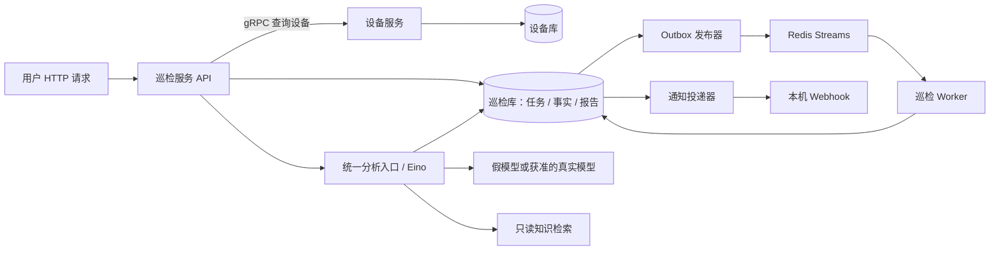

# 一个逐步长出来的业务项目：设备巡检与 AI 报告助手

这套练习的成品是一套有接口、有持久化任务、有权限与异常处理的后台业务。日常问题是：**设备有没有异常，证据是什么，下一步该检查什么？**

业务过程按可交付的工作流程设计，开发输入使用合成设备、临时数据库和本机服务。真实设备采集、真实模型质量及真实外部通知分别验证，不由模拟通过推断。

## 用户如何使用

运维人员 Alice 登记 sw-core，确认设备启用，提交一次巡检。接口立即给出任务编号；稍后查询时能看到运行状态、完成报告和就绪通知。

报告显示：这次教学采样 CPU=92%，按 teaching-cpu-v1 的 80% 阈值判为异常；同时列出采样时间和 fact_id。AI 再读取这份报告及本地排障知识，解释依据、列出可能原因和建议，也标明“单次样本不能证明持续过载”。

Alice 可以回看旧报告；改设备名不会改历史证据。Bob 无法凭猜到的编号读取 Alice 的任务。重复点击提交只得到一份任务；队列或 worker 中断后系统能恢复。

**80% 是本练习自行设定的教学阈值，不是厂商标准。** null 代表缺失，不得当成 0 或正常。给定样例见 [fixtures](fixtures/README.md)。

## 哪一段解决什么

| 题目 | 业务成果 |
|---|---|
| 01–06 | 接口可访问、能接收资料，故障有响应，行为能自动检查 |
| 07–10 | 能解释 IP、网段与连通性，理解采集入口会怎样失败 |
| 11–24 | 设备资料可保存、查询和维护，理解 HTTP、SQL 与框架各自的作用 |
| 25–28 | 可启停设备、提交任务、留下事实、查到不可变报告 |
| 29–30 | 只有本人能访问任务，重复提交不产生重复工作 |
| 31–34 | 报告缓存、异步队列、故障重试、报告就绪通知 |
| 35–40 | Kratos 合同、两个服务、gRPC、服务发现、可观测性和可重复启动 |
| 41–46 | Eino 模型调用、证据校验、Graph、RAG、只读 Agent 与流式进度 |
| 47 | 单独验证一次获准的真实模型调用 |
| 48 | 用业务场景证明完整系统的正常与失败行为 |

前 24 题是这个业务的基础能力。chi、gin、Kratos 分阶段比较和迁移；成品只选一套 HTTP 业务入口，避免为不同框架维护三份规则。

## 技术各自负责什么

| 技术 | 在本项目中的职责 |
|---|---|
| net/http、net | 理解请求响应、客户端、连接、超时、资源关闭 |
| database/sql、SQLite | 先亲手理解持久化、参数绑定、唯一约束和事务 |
| chi / gin | 用已经熟悉的业务对照不同 HTTP 组织方式 |
| gorm | 组织数据库访问，继续保留可解释的约束与事务 |
| HTTP/框架中间件 | 认证、请求编号、日志、错误处理 |
| Redis | 缓存不可变报告；Streams 交付后台任务 |
| Kratos | 明确服务合同，组织 HTTP/gRPC、配置、生命周期及中间件 |
| etcd | 让调用方按服务名找到当前实例 |
| OpenTelemetry | 关联入口、RPC、后台执行和模型阶段 |
| Eino | 组织模型组件、分析 Graph、检索与有限的只读工具调用 |
| Docker Compose | 重现本地多服务环境 |

这里“中间件”包括两种常见含义：代码中包在请求外面的认证/日志组件，以及 Redis、etcd 这类独立运行的基础服务。

## 分两次形成架构

先做一个进程中的模块化业务：设备、巡检、报告、分析分别是可测试的函数或模块。到第 36 题再拆进程：

这是练习的目标结构，不代表当前已有实现。Worker 属于巡检服务的业务边界，复用同一套执行与写入规则。两个服务各自拥有数据库，禁止跨服务直接查对方表。第 36 题先静态地址，第 38 题再接服务发现。

## 最小业务合同

- 设备：已有 id/name/ip/enabled；提交时检查存在和启用。设备更新不回写任务快照。
- 任务：记录 owner、设备快照、时间、状态与失败原因。状态从 queued 到 running，再到 succeeded/failed；可重试故障经明确规则回 queued，最终失败不得无限重试。
- 事实：本次采集得到的值、时间、来源与唯一 fact_id。数据缺失和执行失败分开记录。
- 报告：一份任务对应一份最终快照，包含规则版本、证据和判定；完成后不可重算覆盖。
- 分析：单独关联报告，保存输出、提示版本、fake/live 标记与引用。允许多次请求产生不同分析，不能覆盖原事实。
- 投递：报告就绪事件的发送记录；接收器按 event_id 去重。报告完成与投递成功分别查询。

新表只在对应题目开始时建立。每次先写清写入者、读取者、唯一约束、失败与回滚方式。第 32 题 outbox、第 33 题租约都服务具体失败场景，不为了套架构提前添加。

## 最终接口轮廓

以下是逐题形成的合同；当前文件是需求，不是已经运行的服务：

| 动作 | 入口 | 主要结果 |
|---|---|---|
| 登记、读取设备 | POST /devices；GET /devices/{id} | 已保存的设备 |
| 启停设备 | PATCH /devices/{id}/enabled | enabled 更新 |
| 提交、查询巡检 | POST /inspection-jobs；GET /inspection-jobs/{id} | 202 受理、后续状态 |
| 查看报告 | GET /inspection-jobs/{id}/report | 证据与规则快照 |
| 触发、查看 AI 分析 | POST /reports/{id}/analyses；GET /analyses/{id} | 有证据引用的独立分析 |
| 流式分析 | 第 46 题定义新分析的 SSE 入口 | 阶段进度及最终编号 |

Kratos 的 protobuf/gRPC 合同可以不同于 HTTP 表达，但转换必须显式，尤其是数字 ID 的 JSON 类型。HTTP 验收不能因为换框架就悄悄改变。

## 真实与模拟的验证边界

默认所有自动测试用 fake，核心业务结果仍须在本地真实程序、数据库和组件中执行验证。Redis/etcd/Compose 集成需要真的启动本地依赖，不能仅靠内存替身就标为集成通过。

真实模型在第 47 题按选定供应商、样例与预算单独授权；如果未执行，记录 live 未验证。真实设备和钉钉不在本次默认练习范围，后续有具体对象和动作再增加适配。真实请求成功也不直接证明模型建议正确。

[学习路线](README.md) · [从第 25 题开始业务整合](exercises/25-business-device-enabled/README.md) · [先做第 01 题](exercises/01-http-health/README.md)

## 在同一项目继续开发与运维

48题是基础业务阶段交付，最终开发运维交接在69题。49–69复用设备、任务、事实、报告与权限合同，不另起无关项目。

- 49–54：并发更新、锁、死锁、优化、恢复、MongoDB。
- 55–56：RabbitMQ 通知交付、Kafka 事实回放。
- 57–62：Linux、Nginx、日志、监控、异步追踪与容器数据。
- 63–64：部署、探针、资源、可用性与排障。
- 65–69：流水线、兼容迁移、灰度验证、回滚与故障演练。

各题“知识串讲.md”讲当前知识，README.md给对应改动与验收。RabbitMQ做通知交付对照，Kafka做回放统计投影，MongoDB做报告正文仓储对照；按配置选用，保持一份权威事实和一套业务规则。

[从49题继续](exercises/49-sql-concurrent-device/README.md) · [最终交接](exercises/69-devops-project-handover/README.md)
